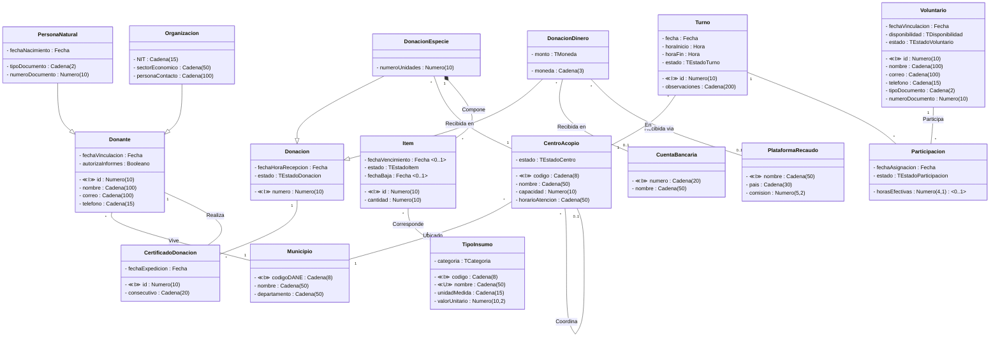

# ESCUELA COLOMBIANA DE INGENIERIA

## MODELOS Y SERVICIOS DE DATOS - MYSD G04

## PARCIAL PRIMER TERCIO. Nota esperada: ______

### S11. 2026-02

---

> Para **Fundacion Puente Solidario** ciclo uno vamos a trabajar el area de: **VOLUNTARIOS**
>
> La fundacion coordina voluntarios que apoyan las labores operativas en los centros de acopio. De cada voluntario se registra un codigo, nombre, correo electronico, telefono, tipo y numero de documento, fecha de vinculacion, disponibilidad (tiempo completo, medio tiempo o fines de semana) y estado (activo, inactivo o suspendido). Un voluntario solo puede ser asignado a turnos si su estado es activo.
>
> Los voluntarios participan en turnos programados en los centros de acopio. De cada turno se registra un codigo, la fecha, la hora de inicio y fin, las observaciones y el estado (programado, en curso, completado o cancelado). Un turno pertenece a un unico centro de acopio y un centro puede tener multiples turnos. Un turno puede contar con varios voluntarios y un voluntario puede participar en varios turnos a lo largo del tiempo.
>
> De cada participacion de un voluntario en un turno se registra la fecha de asignacion, las horas efectivas aportadas y el estado de la participacion (asignado, confirmado, cumplido o ausente). Las horas efectivas solo se registran cuando el turno ha sido completado. No se permiten participaciones sobre turnos cancelados y siempre se controla la disponibilidad del voluntario.

---

## Modelo Conceptual Extendido

> **Nota:** `CertificadoDonacion` es una clase de asociacion sobre la relacion muchos-a-muchos entre `Donante` y `Donacion`. `Participacion` es una clase de asociacion sobre la relacion muchos-a-muchos entre `Voluntario` y `Turno`. Ambas se representan como clases intermedias en Mermaid. La relacion entre `DonacionDinero` y `CuentaBancaria`/`PlataformaRecaudo` tiene una restriccion {XOR}: se recibe en una **o** la otra, nunca ambas. La relacion `Coordina` en `CentroAcopio` es una autorelacion (centro principal coordina centros satelite).

---

## (30%) MODELO RELACIONAL (Modelo mini)

Transforme el modelo conceptual extendido anterior en un modelo relacional usando el estandar minimo. Marque cada CRUD en un color diferente.

---

## (20%) MODELO RELACIONAL. INTEGRIDAD DECLARATIVA. (SQL Estandar)

Seleccione e implemente los mecanismos necesarios para las siguientes restricciones:

1. El estado del turno solo puede ser: programado, en curso, completado o cancelado.
2. Si un item se encuentra en estado 'dado de baja', debe tener registrada una fecha de baja; si no esta en dicho estado, la fecha de baja debe ser nula.
3. La hora de fin de un turno debe ser estrictamente posterior a la hora de inicio del mismo turno.
4. El correo electronico de un voluntario no puede ser repetido.

---

## (20%) MODELO RELACIONAL. INTEGRIDAD PROCEDIMENTAL. (SQL Estandar)

Seleccione y explique los mecanismos necesarios para cumplir con las siguientes reglas de negocio:
**(SOLO DISENO. NO LAS IMPLEMENTE)**

**Registrar TURNO**

- ***Adicionar***
    - o Al registrar un turno, el codigo debe ser generado automaticamente por el sistema. La fecha del turno no puede ser anterior a la fecha actual. El estado inicial de todo turno debe ser 'programado'.
    - o Un turno solo puede registrarse en un centro de acopio cuyo estado sea 'habilitado'.
    - o No es posible programar un turno cuyo horario (fecha, hora de inicio y hora de fin) se solape con otro turno ya existente en el mismo centro de acopio.
    - o Un turno no puede registrarse si la duracion resultante (diferencia entre hora de fin y hora de inicio) es inferior a 2 horas o superior a 12 horas.

- ***Modificar***
    - o Una vez que un turno tenga estado 'completado', no podra modificarse ninguno de sus campos.
    - o Si la fecha actual supera la fecha del turno y el turno aun se encuentra en estado 'programado', el estado debe cambiar automaticamente a 'cancelado'.
    - o Al cambiar el estado de un turno a 'completado', las horas efectivas de todas las participaciones asociadas con estado 'confirmado' deben calcularse automaticamente con base en la hora de inicio y fin del turno.

- ***Eliminar***
    - o Un turno no puede eliminarse si su estado es diferente a 'programado'.

---

## (30%) CONSTRUCCION. (SQL ORACLE) Entregar en un .sql con sus nombres

1. Implemente la estructura de las tablas disenadas en el diagrama conceptual. (Sin restricciones de integridad externa).
   **SOLO SE PIDEN LAS RESTRICCIONES PROPIAS DE LA DEFINICION DE TABLAS**

2. Implemente todas las restricciones de integridad declarativa correspondientes al CRUD: **Registrar Donacion**
   **UNICAMENTE LAS RESTRICCIONES DE ESE CRUD Y LAS NECESARIAS PARA ELLAS.**

3. Implemente los mecanismos disenados anteriormente para cumplir las reglas de negocio del caso de uso (Integridad Procedimental): **Registrar Donacion**

---

## BONO

Como mejoraria el modelo conceptual extendido? Por que? (+0.2)
